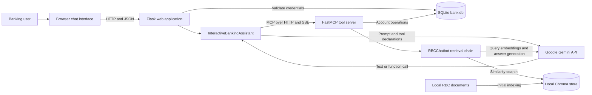
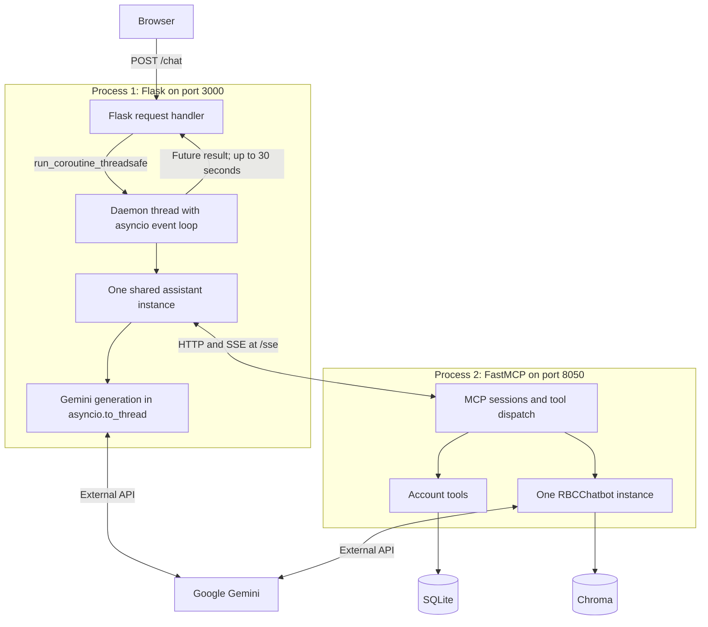
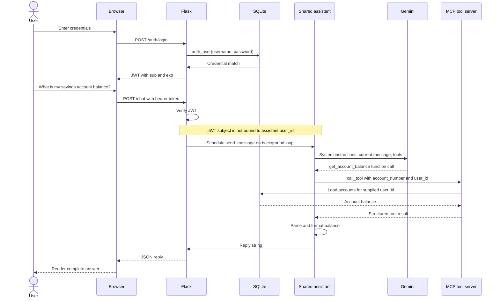
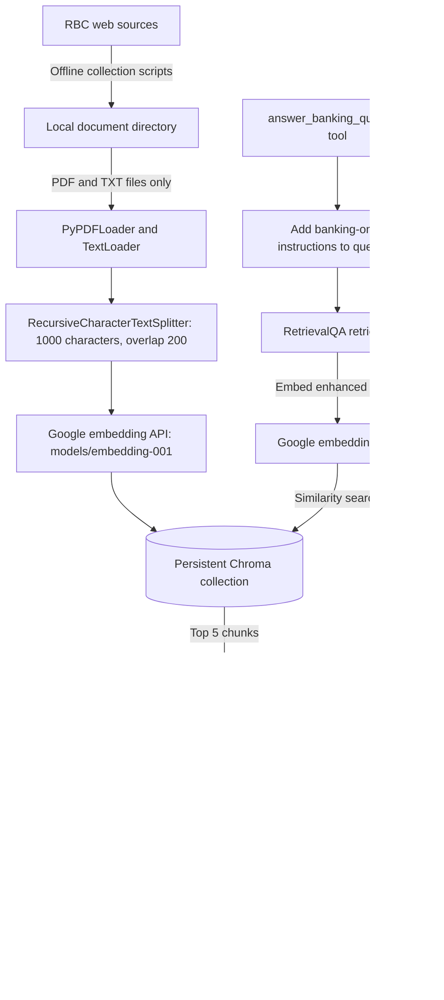
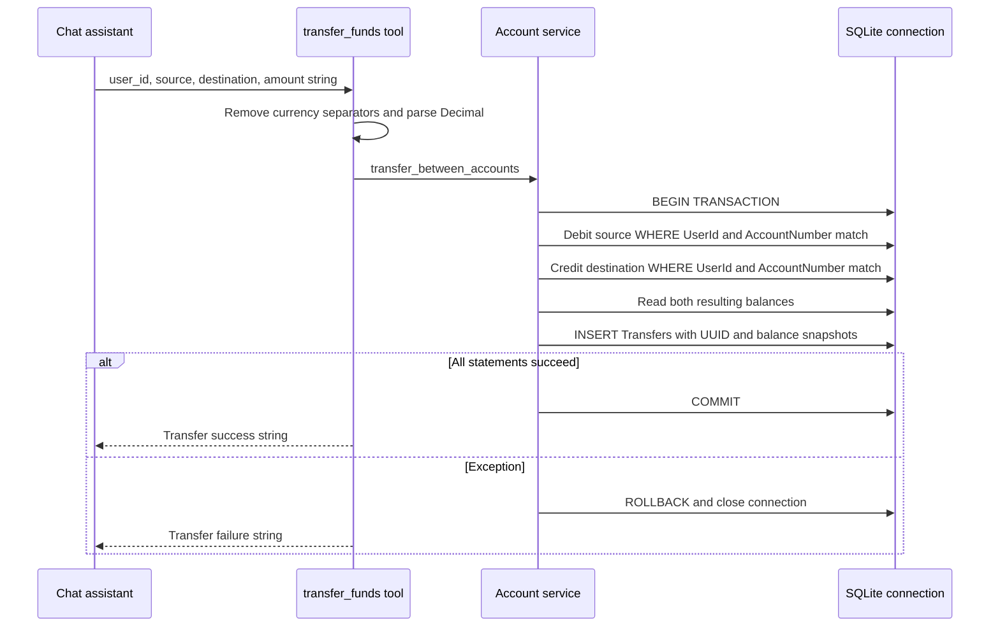
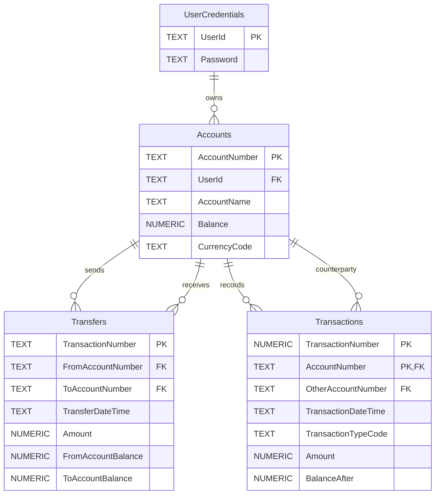

# Application Architecture

## 1. Purpose and Scope

The RBC AI Banking Agent is a local demonstration application that combines a browser chat interface, Gemini function calling, simulated banking operations, and retrieval-augmented generation (RAG) over downloaded RBC documents.

This document describes the implementation as of 2026-11-02, not a proposed production architecture. Account balances and transfers are stored in local SQLite; there is no connection to a real bank or payment network. Security and isolation limitations are documented in Section 10.

The primary use cases are account listing, balance inquiries, transfers between accounts, transaction history, and document-backed banking questions. Diagrams use Mermaid and can be viewed in a Mermaid-enabled Markdown preview.

## 2. High-Level Design

### 2.1 System Context



There are two long-running Python processes. Flask serves the UI and orchestrates chat. The FastMCP server exposes tools and owns RAG initialization. Both processes can access the same SQLite file; only the MCP/RAG process needs the vector store for the main web workflow.

Gemini chooses a tool, but Python executes it. Account tools return database results directly to the formatter; the implementation does not send their results through a second Gemini generation step. General banking questions trigger a separate RAG generation call.

### 2.2 Design Choices

| Choice | Current implementation and consequence |
| --- | --- |
| Separate orchestration and tool execution | The web process uses an MCP client; banking and RAG tools live in the MCP server process. |
| Local relational persistence | SQLite stores demo users, accounts, transfers, and a separately declared transaction table. |
| Local semantic index | Chroma persists document chunks and embeddings on disk. Embeddings still require Google's API. |
| Model-driven routing | Gemini receives static function declarations and selects operations from natural-language input. |
| Deterministic output formatting | Python formats tool results instead of asking the model to rewrite account data. |
| Legacy LangChain chain | `RetrievalQA` uses the `stuff` strategy with the top five retrieved chunks. |
| Browser request/response | Chat replies arrive as complete JSON responses, not streamed tokens. SSE is used on the internal MCP connection. |

## 3. Components and Ownership

| Component | Source | Responsibility |
| --- | --- | --- |
| Web entry point | [app.py](app.py) | Flask routes, JWT creation and validation, shared assistant, background asyncio loop. |
| Browser view | [templates/chat.html](templates/chat.html) | Page, chat popup, login form, and chat controls. |
| Browser behavior | [static/script.js](static/script.js) | Login requests, in-memory bearer token, chat requests, typing indicator, Markdown-like rendering, dragging and resizing. |
| Styling | [static/style.css](static/style.css) | Page and chat presentation. |
| Chat orchestrator | [chatbot/mcp/client_sse.py](chatbot/mcp/client_sse.py) | MCP session, Gemini function calling, command handling, response parsing, and tool invocation. |
| Prompt and tool schemas | [chatbot/config_client.py](chatbot/config_client.py) | System instructions, model generation settings, and function declarations passed to Gemini. |
| Command detector | [chatbot/intent_detector.py](chatbot/intent_detector.py) | Recognizes exit, clear, and user-switch commands; it is not the semantic banking-intent classifier. |
| Tool server | [chatbot/mcp/server_sse.py](chatbot/mcp/server_sse.py) | Registers six FastMCP tools, initializes RAG and SQLite, implements balance and history tools. |
| Account service | [chatbot/account.py](chatbot/account.py) | Thin facade over database account and transfer functions. |
| Relational access | [chatbot/database.py](chatbot/database.py) | Credential lookup, account queries, transactional transfer updates, database bootstrap. |
| Data object | [chatbot/models.py](chatbot/models.py) | `Account` with account number, name, and `Decimal` balance. |
| Result presentation | [chatbot/response_formatter.py](chatbot/response_formatter.py) | Function-specific text formatting and HTML source lists for RAG answers. |
| RAG service | [chatbot/rag/rag_chatbot.py](chatbot/rag/rag_chatbot.py) | Process-local singleton, index existence check, retriever, generation chain, source extraction. |
| Index access | [chatbot/rag/vector_store.py](chatbot/rag/vector_store.py) | Gemini embedding configuration and persistent Chroma creation/loading. |
| Document processing | [chatbot/rag/document_loader.py](chatbot/rag/document_loader.py) | Recursive PDF/text loading and overlapping text splitting. |
| Document acquisition | [chatbot/rag/rbc_explorer.py](chatbot/rag/rbc_explorer.py), [chatbot/rag/save_investment_faqs.py](chatbot/rag/save_investment_faqs.py) | Offline collection of source documents and FAQ text. |
| Alternative RAG entry point | [chatbot/rag/app.py](chatbot/rag/app.py) | Console-only document Q&A without the web login or banking tool workflow. |

## 4. Runtime and Concurrency



Flask creates the assistant and starts its daemon thread at module import time. The thread initializes the MCP connection with `run_until_complete`, then keeps its event loop running. Each authenticated chat request schedules `send_message` on that loop and synchronously waits on its future for up to 30 seconds.

The assistant offloads the blocking Gemini SDK generation call with `asyncio.to_thread`. It awaits MCP tool calls over the established session. Multiple HTTP requests can overlap; there is no per-user assistant isolation or request serialization around shared conversation state.

If MCP initialization raises, the background thread never reaches `run_forever`; Flask has no explicit readiness gate or reconnection policy. A web request timing out does not explicitly cancel the scheduled assistant coroutine, so underlying work can continue after the HTTP response.

## 5. Request Flows

### 5.1 Login and Account Inquiry



The browser stores the access token in a JavaScript variable, not persistent storage. Reloading the page loses it. Tokens expire after 15 minutes; there is no refresh-token endpoint or server-side logout/revocation mechanism.

`send_message` appends messages to `conversation_history`. Although `build_prompt` can incorporate that history, the current generation call sends only the system instructions and current user message. Stored history therefore does not provide model conversation context on this path.

For non-RAG tools, `_execute_function_call` adds the assistant's `user_id` only when the model has not already supplied one. The initial value is `test1`; the `user <id>` command mutates it. The system prompt and account mappings contain fixed demo account numbers.

### 5.2 Document Ingestion and RAG



On construction, `RBCChatbot` checks whether the vector directory exists. If absent, it loads documents, splits them, and creates the index before the MCP server starts accepting requests. If present, it loads the existing store without checking source changes, document count, index completeness, or embedding compatibility.

The collector can download more formats than the indexer supports; the ingestion implementation reads only PDF and TXT. Per-file load failures are logged and skipped. The no-document-directory branch attempts an empty index; successful creation of an empty index is not guaranteed by this application.

For Q&A, banking instructions are prepended to the question before invoking the chain. Consequently, retrieval embeds this enhanced query, not just the raw user question. The chain returns the answer and source documents; source metadata is deduplicated with a set, so ordering is not stable. Sources are file metadata, not necessarily original web URLs or page-level citations. A small string-based check suppresses sources for certain refusal responses.

This path involves the routing model, a query embedding call, and a separate answer-generation call. No automatic document refresh, scheduled indexing, reranker, or retrieval-quality threshold is implemented.

### 5.3 Transfer Transaction



Both account updates and the transfer record share one SQLite transaction. `Transfers` stores a UUID identifier, an ISO-formatted local timestamp, amount, and resulting balances. The optional service `description` parameter is not persisted. History is synthesized from `Transfers`; the separate `Transactions` table is not populated by this flow.

This atomicity is not complete financial validation. There are no explicit positive-amount, sufficient-funds, distinct-account, currency-match, affected-row-count, or idempotency checks. Python uses `Decimal`, but SQLite columns use `NUMERIC`, so this is not a guaranteed fixed-point accounting implementation.

## 6. Interface Contracts

### 6.1 Browser HTTP API

Defined in [app.py](app.py).

| Method and route | Input | Success | Failure behavior |
| --- | --- | --- | --- |
| `GET /` | None | Render chat template. | Flask template errors are not specially handled. |
| `GET /static/<path>` | Asset path | Flask's static assets. | Missing assets return 404. |
| `POST /auth/login` | JSON `username`, `password` | 200 with `status`, `access_token`, `token_type`. | Missing fields: 400; incorrect credentials: 401 with `status: fail`. |
| `POST /chat` | Bearer JWT and JSON `message` | 200 with `reply`; non-string results may be JSON-serialized into the reply string. | Missing/invalid/expired token: 401; empty message: 400; future failures/timeouts: 500. |

Some `abort` responses are Flask HTML rather than the JSON expected by the browser. Exceptions caught inside the assistant or RAG layer become ordinary reply strings and can therefore return HTTP 200 despite an unsuccessful action. The browser's chat handler parses JSON without first branching on HTTP status.

### 6.2 MCP Tool API

The default server is named `RBC-RAG-MCP`, with an SSE connection at `http://127.0.0.1:8050/sse`. This is a protocol endpoint, not a browser homepage. The framework supplies the associated MCP message transport routes.

| Tool | Parameters | Result and implementation |
| --- | --- | --- |
| `answer_banking_question` | `question: str` | Dictionary with `answer` and `sources`; delegates to RAG. |
| `list_user_accounts` | `user_id: str` | List of account dictionaries from `Account.__dict__`. |
| `list_target_accounts` | `user_id: str`, `from_account: str` | Other accounts for the supplied user. |
| `transfer_funds` | `user_id: str`, `from_account: str`, `to_account: str`, `amount: str` | Human-readable success/failure string. |
| `get_account_balance` | `user_id: str`, `account_number: str` | Account number/name, string balance, hard-coded `CAD`, or an error dictionary. |
| `get_transaction_history` | `user_id: str`, `account_number: str`, `days: int = 30` | Newest-first transfer-derived records with signed amounts and resulting balances. |

Tool declarations are duplicated between the client configuration and server decorators. No automatic synchronization with server-discovered tool schemas is implemented in the chat path.

`_parse_function_result` unwraps MCP text content and attempts JSON decoding, including normalizing a single history record into a list. `ResponseFormatter` dispatches by tool name. History presentation shows at most five records, while the tool itself returns all matching records. There is no dedicated target-account formatter, so that operation falls back to generic formatting.

The prompt asks for at most one tool per request, but the response processor loops over function-call parts; this restriction is prompt guidance rather than enforced server policy.

## 7. Persistence Design

### 7.1 Relational Model

Schema and demo seed data are defined in [chatbot/init.sql](chatbot/init.sql).



The diagram shows declared schema relationships, not guaranteed runtime enforcement. Connections do not explicitly enable SQLite foreign keys. The seed includes two `thebank` accounts without a matching credential row. `Transactions` has a composite primary key and is not the source of the implemented history API.

Database initialization executes the SQL script only when the `UserCredentials` table is absent. Its existence is treated as proof of initialization; this is not a schema migration system. Later schema/seed edits are not automatically applied to existing databases.

### 7.2 State Lifetimes

| State | Location | Lifetime and sharing |
| --- | --- | --- |
| Access token | Browser JavaScript variable | Current page lifetime, with a 15-minute JWT expiry. |
| Assistant identity and history | Flask process memory | Shared across requests and users; lost at process restart. |
| MCP session | Web process background loop | Opened on startup; no explicit retry/reconnect policy. |
| Users, accounts, transfers | SQLite file | Persistent; accessed by both processes using separate connections. |
| Raw documents | Document directory | Persistent input to indexing. |
| Chunks, embeddings, metadata | Chroma directory | Persistent; index reused based on directory existence. |
| RAG singleton | MCP process memory | One initialized instance per process; not a distributed singleton. |

## 8. Configuration and Dependencies

Core settings are in [chatbot/config.py](chatbot/config.py); model/tool settings are in [chatbot/config_client.py](chatbot/config_client.py); dependency constraints are in [requirements.txt](requirements.txt).

| Setting | Default or source | Usage |
| --- | --- | --- |
| `GEMINI_API_KEY` | Required environment value | Explicit Google SDK, generation, and embedding credentials. Never expose it in browser assets or logs. |
| `SECRET_KEY` | Insecure demo fallback `your_secret_key` | HS256 JWT signing in Flask. |
| `CHATBOT_DB_FILE` | `bank.db` | SQLite path, resolved relative to the launch directory if not absolute. |
| `VECTOR_DB_DIR` | `./chroma_db` | Chroma persistence path. |
| `DOCS_DIRECTORY` | `./rbc_documents` | RAG ingestion source directory. |
| `MCP_HOST` | `127.0.0.1` | Server bind host and client connection host. |
| `MCP_PORT` | `8050` | MCP server and client port. |
| `MCP_NAME` | `RBC-RAG-MCP` | MCP server identity. |
| `DEFAULT_USER_ID` | Code constant `test1` | Initial shared assistant identity. |
| Chat model | `gemini-3-flash-preview`, temperature `0.1` | Client function calling; tool mode `AUTO`. |
| RAG model | `gemini-3-flash-preview`, temperature `0.2` | Separately hard-coded in `RBCChatbot`. |
| Embedding model | `models/embedding-001` | Separately hard-coded for indexing and queries. |
| Web listener | `0.0.0.0:3000` | Flask development server with debug enabled and reloader disabled. |

The chat client loads the project-root `.env` relative to its own file. RAG modules use default dotenv discovery, and the MCP entry point also contains a working-directory-relative dotenv call. Core configuration is read at import time, so environment variables needed by that module should be exported before launch; late dotenv loading does not recompute already-imported settings.

Model changes require process restarts. A model being listed does not prove that the configured project has generation quota or access. The Google `google-generativeai` SDK is deprecated, and preview model identifiers can change. Generation and embedding availability must be assessed separately; replacing the embedding model can require rebuilding the index.

Compatibility constraints currently include `mcp==1.9.1`, `pydantic>=2.7.2,<2.11`, and `langchain>=0.1.0,<1.0`. Most other dependencies are ranges, not a fully locked reproducible environment. The README's Python minimum is not a tested compatibility matrix for all resolved dependencies.

## 9. Startup and Local Operation

Run both processes from the repository root so relative database and document paths resolve consistently.

```bash
uv venv .venv
uv pip install --python .venv/bin/python -r requirements.txt
```

Provide `GEMINI_API_KEY` through the local project `.env` or process environment. Set a non-default `SECRET_KEY` before exposing the app beyond a disposable local demo. Do not put actual secret values in tracked documentation.

Start the MCP server first:

```bash
uv run --no-project --python .venv/bin/python python -m chatbot.mcp.server_sse
```

Startup initializes SQLite, creates/loads RAG state, and only then starts the SSE listener. First-run document parsing and remote embedding can delay readiness substantially. An existing vector directory avoids automatic reindexing but does not prove the collection is populated.

Start Flask in a separate terminal:

```bash
uv run --no-project --python .venv/bin/python python app.py
```

Open `http://localhost:3000`. The seeded demo login is `test1` / `password1`; these credentials are public test data, not a production account. The MCP endpoint is not the UI; a 404 at its root path is expected.

Alternative workflows are document acquisition via `python -m chatbot.rag.rbc_explorer` and `python -m chatbot.rag.save_investment_faqs`, and console Q&A via `python -m chatbot.rag.app`; run these with the same uv environment prefix used above. Refreshing documents alone does not refresh an existing index.

Operational output is console logging. There are no dedicated health/readiness endpoints, structured request correlation, application metrics, distributed tracing, automated migrations, or backup/restore orchestration in the examined main path.

## 10. Trust Boundaries and Known Limitations

This is not production-ready banking software. These are implementation gaps, not guarantees supplied by prompts or JWT authentication.

| Area | Observed behavior and impact |
| --- | --- |
| Authentication | Demo passwords are plaintext in SQLite; JWT signing has a public fallback secret; no login throttling or token revocation is implemented. |
| User isolation | Flask verifies JWT identity but does not bind it to tool identity. One mutable assistant and history are shared. Model-supplied user IDs are accepted; a user-switch command is available. |
| Tool authorization | MCP tools have no application authentication layer. History accepts `user_id` but its SQL filters only by account number/date, not ownership. Binding to loopback is not a substitute for authorization. |
| Financial correctness | Atomic updates exist, but business validation, idempotency, confirmation policy, and a robust fixed-point ledger are absent. Same-account transfers and invalid amount semantics are not explicitly rejected. |
| Model policy | Banking-only behavior, one-tool selection, and transfer intent are prompt instructions, not deterministic authorization controls. Retrieved documents and model output are untrusted inputs. |
| Frontend rendering | User messages are escaped, but assistant/system content is inserted as HTML through a custom Markdown parser without a sanitization library. Source labels are also interpolated into HTML. |
| Sensitive data | Debug logs include prompts, tool arguments, account information, and tool results. Prompts and retrieved document context are sent to Google; document text is sent for embedding. |
| Availability | Model retirement, quota exhaustion, API latency, initial indexing, MCP connection failure, and SQLite contention can prevent successful requests. No coordinated retry/circuit-breaker policy is implemented. |
| Error semantics | Errors may be returned as success-status chat text. Some formatting fallbacks can obscure tool failures. A 200 response alone is not proof that an action succeeded. |
| Index freshness | Directory existence substitutes for index readiness; no versioned ingestion manifest, incremental refresh, or embedding migration is implemented. |
| Conversation continuity | History is stored but omitted from the active model prompt; the UI and prompts can imply stronger multi-turn behavior than is implemented. |
| Deployment | Flask debug mode and the development server are enabled; browser HTTP and internal MCP traffic have no application-configured TLS. |

Before a multi-user or externally reachable deployment, prioritize identity propagation and server-side authorization, per-user state, password hashing and secret management, validated/idempotent transfer semantics, output sanitization, and production serving/readiness controls. These are recommended follow-up changes, not functionality implemented by this document.

## 11. Verification Boundaries

An architecture-level smoke test should verify login rejection/acceptance without logging tokens, authenticated chat through the background loop, MCP initialization and tool discovery, a read-only balance matching SQLite, RAG retrieval against a known indexed document, and failure handling when MCP or Google is unavailable.

Transfer validation should use a temporary database and verify atomic balance changes, recorded snapshots, rollback on failure, and explicit handling of invalid amounts/accounts. Multi-user testing must demonstrate isolation and authorization; the current implementation does not provide those guarantees.

This document is grounded in the linked source files. It does not certify external model availability, embedding compatibility, document completeness, or production readiness. No application behavior is changed by adding this documentation.